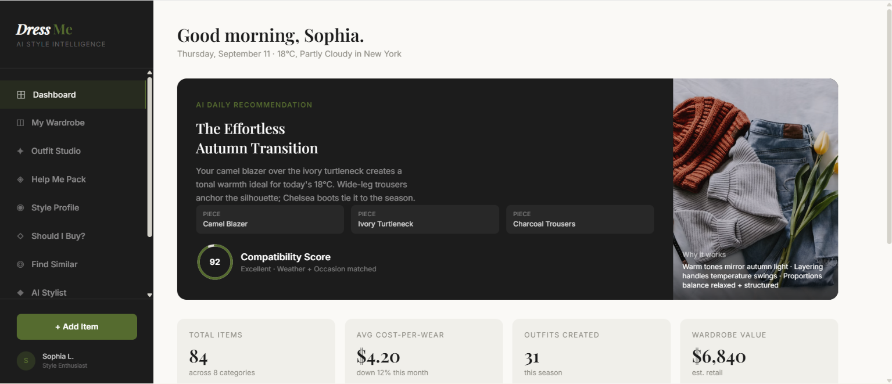
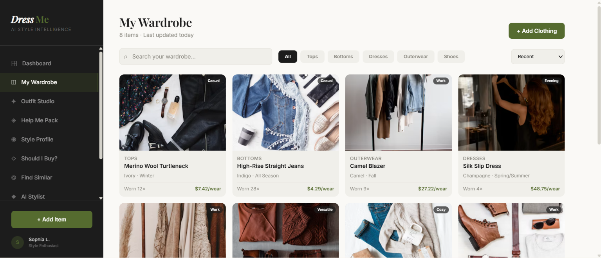
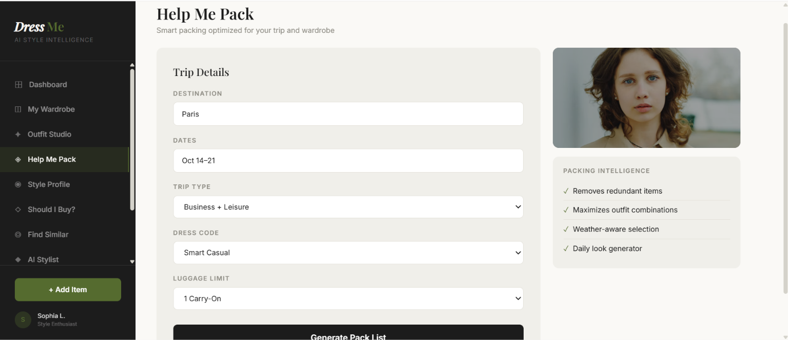

# DressMe

**Your smart wardrobe, your personal fashion assistant.**

DressMe is a smart wardrobe ecosystem designed primarily for the **Tunisian market**. The idea is simple: most people own more clothes than they wear, forget what they already own, and end up buying duplicates. DressMe turns a physical wardrobe into a structured, queryable digital one, then uses that understanding to help with everyday decisions — what to wear, what to pack, what to buy, and what to let go.

> **Project status — please read first.**
> This repository currently contains the **UI / Figma prototype** of DressMe. It is the visual and UX reference for the future application, not the application itself. Product, architectural, and AI decisions are still under discussion and are **not finalized**. Nothing described in the roadmap or AI sections below is implemented yet.

---

## Table of Contents

- [GitHub Rules for the Team](#github-rules-for-the-team)
- [Project Overview](#project-overview)
- [Business Objectives](#business-objectives)
- [AI & Multi-Agent Architecture](#ai--multi-agent-architecture)
- [Prototype](#prototype)
- [Screens](#screens)
- [Current Status](#current-status)
- [Roadmap](#roadmap)
- [Repository Structure](#repository-structure)
- [Disclaimer / Project Status](#disclaimer--project-status)

---

## GitHub Rules for the Team

These rules are not suggestions. They exist so that five people can work on DressMe at the same time without stepping on each other.

### 1. Never work on `main`

`main` is the integration branch. It must always stay runnable.

```bash
git checkout main
git pull
```

### 2. One branch per feature — always create a branch

Never commit a feature directly to `main`. Before writing any code:

```bash
git checkout main
git pull
git checkout -b feature/helpmepack-form
```

**Branch naming:** `feature/<feature-folder>` — the branch name always matches the folder you are building.

| Type | Format | Example |
| --- | --- | --- |
| Feature | `feature/<name>` | `feature/helpmepack-form` |
| Fix | `fix/<name>` | `fix/wardrobe-search-empty-state` |
| Refactor / chore | `chore/<name>` | `chore/split-app-into-features` |

Rules: lowercase, hyphens instead of spaces, one branch = one feature.

### 3. Clear folders — one folder per feature

Every feature gets its own folder, named in lowercase with no spaces. Sub-parts of a feature go in a child folder.

```text
src/
└── features/
    ├── helpmepack/
    │   ├── form/          # the trip input form
    │   ├── packlist/      # the generated pack list
    │   └── looks/         # daily looks for the trip
    ├── wardrobe/
    │   ├── grid/
    │   └── additem/
    ├── outfits/
    │   └── canvas/
    ├── weather/
    ├── shouldibuy/
    │   └── analysis/
    ├── stylist/
    └── profile/
```

**The convention, precisely:**

- Feature folder = the feature name, lowercase, no spaces: `helpmepack`, `shouldibuy`, `wardrobe`.
- Sub-feature = `<feature>/<part>`: `helpmepack/form` is the input data form of the Help Me Pack feature.
- One folder = one screen or one self-contained piece of UI. If a folder gets confusing, split it further rather than growing one giant file.
- Shared code goes in `src/components`, `src/lib`, `src/hooks` — never duplicated inside a feature folder.

> The prototype is currently one large `App.tsx`. As you touch each feature, split that section into its own folder under `src/features/`. Do not rewrite the whole app in one branch.

### 4. Commit early, commit small

Use [Conventional Commits](https://www.conventionalcommits.org/) — the repo already follows this format:

```text
feat: add trip input form for help me pack
fix: pack list ignores optional items
style: align wardrobe grid spacing
refactor: extract weather card component
chore: add pnpm lockfile
```

Types: `feat`, `fix`, `style`, `refactor`, `docs`, `chore`.

### 5. Open a pull request — no direct pushes to `main`

```bash
git push -u origin feature/helpmepack-form
```

Then open a PR on GitHub. A PR must:

- Target `main`, and be linked to its folder (`helpmepack/form`).
- Explain **what** changed and **why** in two or three lines.
- Include a screenshot or screen recording for anything visual.
- Keep to one feature. Do not mix a refactor with a new feature in the same PR.
- Pass CI and get **one approval** before merge.

Use **Squash and merge** so `main` history stays readable.

### 6. Keep your branch current

```bash
git fetch origin
git rebase origin/main
git push --force-with-lease
```

Rebase often — daily if several people are active. Never force-push to `main`.

### 7. Don't commit junk

- Never commit `node_modules`, `.env`, API keys, or local settings. `.gitignore` already covers most of this.
- Commit generated files (like `pnpm-lock.yaml`) but never build output (`dist/`, `.vite/`).
- Keep `README.md` and this rules section up to date when you change the structure or the BOs.

### 8. Ownership

Check open PRs before starting a feature. If someone already has a branch for it, coordinate instead of forking the same work twice.

---

## Project Overview

DressMe aims to combine four capability areas into a single personalized wardrobe ecosystem:

| Pillar | Role |
| --- | --- |
| **Computer Vision** | Understand a photo of a garment: detect it, segment it, remove the background, classify it, and extract attributes (category, color, pattern, material, season). |
| **Recommendation** | Match and rank items into outfits, packing lists, and purchase decisions based on compatibility rather than generic popularity. |
| **Contextual data** | Weather, destination, occasion, season, luggage constraints, budget, and the user's own style profile. |
| **AI agents** | Conversational and task-oriented agents that combine all of the above and explain their reasoning to the user. |

The end goal is an assistant that *understands* the user's wardrobe and preferences rather than just browsing a catalog. It should be able to answer questions like "what do I wear to a dinner party?" or "what am I missing from my wardrobe?" using only what the user actually owns.

The target context is the Tunisian market: local climate ranges, a retail landscape that differs from Europe/North America, purchasing power constraints, and a fashion reality that is practical rather than trend-driven. Those constraints are a product requirement, not an afterthought.

**What this repository is:** the Figma-derived UI prototype that will serve as the reference implementation of the future frontend. The interface is already navigable and covers the main flows described below.

---

## Business Objectives

Seven business objectives (BOs) structure the product. Each one is written as a **pain the user already feels**, followed by the capability that answers it. Each BO is a distinct capability area, not a UI screen.

### BO1 — Wardrobe Visibility

> *I forget what I own.*

Make the wardrobe legible and structured. A user photographs their clothes; the system removes the background, detects the category, extracts attributes (color, material, pattern, season, style tags), and stores the item. Automatic extraction is never trusted blindly — the user can correct any field. The result is a wardrobe that can be searched, filtered, and sorted, plus a wear log that records what gets used and how often.

### BO2 — Purchase Redundancy

> *I buy the same clothes again.*

Stop the cycle of duplicate purchases. For every item the user considers buying — and for every item already in the wardrobe — DressMe quantifies **how close it is to something they already own**. A second white t-shirt with the same cut is flagged as redundant even if it is not the exact same piece. The output is an honest redundancy score with the evidence behind it: which existing items it duplicates, how similar they are, and how often those are actually worn. The goal is to make the user pause before the purchase, not to forbid it.

### BO3 — Wardrobe Gaps

> *Key pieces are missing.*

Tell the user what their wardrobe is structurally unable to do. DressMap analyses category coverage, colour distribution, and season/occasion representativeness to identify missing key pieces — no versatile layer, no warm outerwear, nothing wearable in heat, no formal option. A gap is only real if it blocks an outfit the user would actually want, so gaps are framed against the user's style profile and their lifestyle, not a generic ideal wardrobe. Output is a prioritised list, not a shopping list.

### BO4 — Contextual Recommendation

> *Weather, occasion and plans never meet.*

Recommend outfits built **only from what the user already owns**, conditioned on the real situation rather than on taste in the abstract. Context inputs: current weather and forecast, occasion and dress code, season, time of day, and the user's declared style. The engine ranks combinations by compatibility of the pieces with each other (silhouette, colour harmony, formality level, layering logic) and by fitness for the context. The target is fewer unused items and no outfit that is technically valid but wrong for the day.

### BO5 — Trust & Transparency

> *I do not trust advice I do not understand.*

A recommendation the user cannot interpret is worthless. Every suggestion ships with its reasoning: which items were used and why, which were rejected and on what grounds, which signal carried the most weight, and what the system is uncertain about. Confidence is shown honestly, including "I am not sure" and "I need more data on your wardrobe." Where an automatic attribute extraction may be wrong, the interface says so and invites correction. Trust is earned by being legibly fallible, not by being authoritative.

### BO6 — Smart Purchasing

> *I buy without thinking about my closet.*

Act as a second opinion **before** the money is spent. Given a screenshot, link, or description of an item, DressMe evaluates it against the existing wardrobe: does it fit the user's style profile, does it work with what they own, is it a near-duplicate of something already owned (BO2), does it fill a real gap (BO3), is the price reasonable relative to the user's spending pattern and budget, and what does it do to the wardrobe's cost-per-wear and composition. The output is a verdict with a purchase score and the reasoning behind it — buy, wait, or skip.

### BO7 — Help Me Pack

> *I have a limited amount of choice of outfits.*

Turn a trip into a small number of **maximally combinable** outfits. The system takes destination, dates, planned activities, dress code, and luggage constraints, then combines them with the user's wardrobe and the destination's weather forecast. It optimises for mix-and-match potential — fewest items, most combinations — so a short trip does not collapse into one worn outfit per day. Each packed item is labelled **own / buy / optional**, redundant pieces are flagged, and a pre-departure gap list appears if something essential is missing. The result is a decision the user can defend: here is why these seven items cover nine days.

---

## AI & Multi-Agent Architecture

DressMe is planned to evolve toward a **multi-agent architecture**: a set of specialised agents, each responsible for a bounded task and aligned to a business objective, collaborating through an orchestration layer.

| Agent | Responsibility | Serves |
| --- | --- | --- |
| **Wardrobe Analysis / Computer Vision Agent** | Garment detection, segmentation, background removal, classification, attribute extraction | BO1 |
| **Redundancy Agent** | Similarity and near-duplicate detection between candidate purchases and owned items | BO2 |
| **Wardrobe Gap Agent** | Category / colour / season / occasion coverage analysis, prioritised gap ranking | BO3 |
| **Contextual Recommendation Agent** | Assembles and scores outfits from the existing wardrobe given weather, occasion, and season | BO4 |
| **Transparency / Explanation Agent** | Produces and audits the reasoning attached to every recommendation | BO5 |
| **Shopping / Purchase Assistant Agent** | Evaluates a prospective purchase against wardrobe composition, style, and budget | BO6 |
| **Packing Agent** | Builds and optimises trip pack lists against weather, activities, and luggage limits | BO7 |
| **Conversational / Orchestrator Agent** | Natural-language entry point; routes requests to the right agent and synthesises responses | All |

The intent is **collaboration, not a monolithic model**. A single system asked to do vision, ranking, reasoning, and conversation at once tends to be weaker and harder to evaluate than specialised components with clear boundaries. Separating them also lets each capability be improved, measured, and replaced independently. Having each agent map to exactly one BO keeps the product honest: if an agent cannot be traced to a business objective, it does not ship.

Concepts and technologies under consideration include:

- **Computer Vision** — garment detection, classification, instance segmentation, background removal, attribute (colour / material / pattern) extraction
- **Recommendation systems** — content-based and hybrid ranking over wardrobe embeddings; compatibility and compatibility scoring
- **LLM-based agents** — reasoning, explanation, and conversational interaction over wardrobe data
- **RAG** — retrieval over contextual fashion and wardrobe knowledge where it adds value
- **Weather and context APIs** — current conditions and forecasts as recommendation inputs
- **User preference and wardrobe history** — style profile, wear logs, cost-per-wear, saved outfits as the personal signal
- **Agent orchestration** — routing, tool access, shared memory, and fallback behaviour between agents

> **This architecture is not finalized.** The agent boundaries, model choices, orchestration framework, data stores, and evaluation strategy are all still being evaluated. The table above describes a direction of travel, not a committed design.

---

## Prototype

This repository contains the DressMe **UI / Figma prototype**, built as a React + Vite + Tailwind application from the Figma Make design. It exists to make the product tangible and testable before the technical implementation is decided.

The prototype is used to:

- **Validate the user experience** — test whether the flows are understandable and worth building.
- **Visualise the features** — show what each of the 7 business objectives looks like as an interface.
- **Define navigation and application flows** — settle the information architecture before a backend constrains it.
- **Demonstrate the 7 BOs** — give concrete form to each objective.
- **Provide a foundation for the technical implementation** — act as the visual and UX reference the real frontend is built against.

The prototype is interactive. Most product data is still hard-coded sample data for illustration: scores, weather, wardrobe items, recommendations, and chat replies. The **account, onboarding, profile, and style-preference flows are now real**: they use Supabase Auth and are persisted in the linked Supabase project (see [User Profile & Preferences](#user-profile--preferences-implemented)). The rest of the prototype will keep evolving as product and technical decisions are refined.

### Prototype screens

Each screen maps to the BOs it is meant to demonstrate:

| Section | Purpose | Related BO |
| --- | --- | --- |
| **Dashboard** | Daily AI recommendation, compatibility score, wardrobe stats, gap and duplicate analysis | BO1, BO2, BO3, BO4 |
| **My Wardrobe** | Item grid with search, category filters, sort by recency / wear / cost-per-wear, add-item flow | BO1, BO3 |
| **Outfit Studio** | Drag-and-drop outfit canvas with live style synergy scoring and suggested additions | BO4, BO5 |
| **Help Me Pack** | Trip form → generated pack list with own / buy / optional states and daily looks | BO7 |
| **Weather & Style** | 7-day forecast with per-day styling guidance from the user's own wardrobe | BO4 |
| **Should I Buy?** | Retail screenshot / URL analysis with purchase score, redundancy risk, and verdict | BO2, BO6 |
| **Find Similar** | Image reference → similar items with match percentages | BO2, BO6 |
| **AI Stylist** | Conversational interface with an active-context panel (weather, occasion, style, wardrobe size) | BO4, BO5 |
| **Style Profile** | Aesthetic affinities, colour palette, preferred occasions, size profile — persisted per user | BO1, BO4 |
| **Settings** | Account, regional preferences (currency, units, size system), AI and notification toggles — persisted per user | — |

---

## User Profile & Preferences (implemented)

The account, onboarding, profile, and preference flows are connected to the existing Supabase project. They do **not** need a local backend server: the frontend talks directly to Supabase using the public anon key, and Row Level Security restricts each user to their own rows.

### What is persisted

- **Auth**: email/password sign-in and sign-up through Supabase Auth. The auth user id is the stable owner of all profile data.
- **`profiles`**: display name, avatar URL, preferred language, country/city (`location` JSONB), default currency, timezone, onboarding completion/step, temperature unit, size system, and notification/AI toggles.
- **`style_profiles`**: preferred styles, favourite colours, avoided colours, preferred occasions, preferred categories, preferred fit, and structured clothing sizes.
- **Onboarding**: three steps (basics, fit/sizes, style). Progress is saved after every step. A user can skip for now and resume from the same step later. `onboarding_completed` is only set after preferences and the final profile update succeed.
- **RLS**: users can select/insert/update only their own `profiles` and `style_profiles` rows. Anonymous access to these tables is revoked. The `ensure_user_profile()` RPC only creates rows for `auth.uid()`.

### Supabase configuration

Add the public Supabase values to `DressMe UI Blueprint/.env`:

```env
SUPABASE_URL=https://<project-ref>.supabase.co
SUPABASE_ANON_KEY=<public-anon-key>
```

- Find both values in **Supabase Dashboard → Project Settings → API**.
- The `anon` / `public` key is safe in the browser because RLS protects the data.
- **Never** put `SUPABASE_SERVICE_ROLE_KEY` in `DressMe UI Blueprint/.env` or any client bundle.

The schema change lives in:

```text
supabase/migrations/20261025140000_profile_and_preferences.sql
```

It has been applied to the linked project and recorded in its migration history. For a fresh environment, apply it with the Supabase CLI (`supabase db push`) or paste it into the SQL editor. The migration is idempotent and only extends the existing `profiles` / `style_profiles` tables.

### Run and verify

From the repository root:

```bash
pnpm --dir "DressMe UI Blueprint" dev
```

Open `http://localhost:8443`. This is the only local process needed for these flows; Supabase is remote.

```bash
pnpm --dir "DressMe UI Blueprint" typecheck
pnpm --dir "DressMe UI Blueprint" test
pnpm --dir "DressMe UI Blueprint" build
```

The tests cover profile/preference validation, form round-tripping, onboarding draft persistence, and the guarantee that a failed preference save does not mark onboarding complete. Live RLS checks were also run against the linked project with temporary users (owner access allowed; cross-account access rejected; anonymous access rejected).

### Notes

- If a profile is missing, the frontend calls `ensure_user_profile()` (with an insert fallback) and initialises `style_profiles` at the same time.
- Existing users are not deleted or overwritten; their current rows are preserved and `onboarding_completed` starts as `false`.
- Account deletion is not exposed in the UI: deleting an auth user still requires a service-role/admin operation.

---

## Screens

### Dashboard



*Daily AI recommendation with compatibility score, wardrobe statistics, wardrobe gap analysis, and potential duplicate detection.*

### My Wardrobe



*Structured wardrobe grid with search, category filtering, wear counts, and cost-per-wear per item.*

### Help Me Pack



*Trip intake and generated pack list, distinguishing items already owned, recommended purchases, and optional additions.*

---

## Current Status

**Done / in progress**

- Product ideation completed around the 7 business objectives.
- UI/UX prototype under development from the Figma design.
- Core navigation and the main feature flows implemented as interactive prototype screens.
- **User accounts, onboarding, profile, and style preferences implemented** against the existing Supabase project, with typed client services, validation, error handling, and RLS policies.
- Version-controlled migration for the profile/preferences schema, plus validation and orchestration tests.

**Still open**

- The broader technical architecture is not yet defined.
- The multi-agent approach is planned but not finalized — agent boundaries, models, and orchestration are unresolved.
- Feature scope, CV models, external APIs, data model, and implementation choices remain under evaluation.
- Wardrobe, outfit recommendation, packing, purchase analysis, and AI chat screens still use mock data; only the profile/preferences domain is persisted so far.

**This is not a finished or production-ready product.**

---

## Roadmap

Indicative only — the order and content may change as decisions are made.

1. **UI / Figma prototype** — *(current)*
2. **UX validation and refinement** — user testing, flow fixes, design system consolidation
3. **Frontend implementation** — production app, real routing, state management, API layer, split into the feature folders described in the GitHub rules
4. **Backend and data architecture** — wardrobe/item schema, user accounts, wear logs, storage for images
5. **Wardrobe computer vision pipeline** — detection, segmentation, background removal, classification, attribute extraction (BO1)
6. **Recommendation and contextual intelligence** — compatibility scoring, occasion/weather conditioning, ranking (BO4), gap and redundancy analysis (BO2, BO3)
7. **Multi-agent architecture integration** — agent definitions, orchestration, shared memory, RAG, explanation layer (BO5)
8. **Testing and evaluation** — CV accuracy, recommendation quality, agent task evaluation, user studies
9. **Iterative refinement** — feedback-driven improvement across the pipeline

---

## Repository Structure

The structure below is **indicative and will change** as the prototype transitions into the full application:

```text
DressMe/
├── UI / prototype/   # Current Figma-derived prototype (this repository today)
├── frontend/         # Production frontend (planned)
│   └── src/features/ # One folder per feature — see the GitHub rules above
├── backend/          # Services, APIs, persistence (planned)
├── ai/               # Vision pipeline, agents, orchestration (planned)
└── docs/             # Product, architecture, and evaluation notes (planned)
```

Today the repository holds the prototype application and screenshots:

```text
DressMe/
├── README.md
├── dashboard.png
├── wardrobe.png
├── helpmepack.png
└── DressMe UI Blueprint/          # React + Vite + Tailwind prototype
    ├── index.html
    ├── package.json
    ├── vite.config.ts
    ├── tsconfig.json
    └── src/
        ├── main.tsx
        ├── App.tsx                # All prototype screens and navigation
        ├── index.css
        └── features/              # Created as features are split out
            ├── helpmepack/form/
            ├── wardrobe/grid/
            └── ...
```

### Running the prototype

```bash
cd "DressMe UI Blueprint"
pnpm install
pnpm dev
```

Requires Node.js and pnpm (versions pinned in `.mise.toml`). Copy `DressMe UI Blueprint/.env.example` to `.env` and add `SUPABASE_URL` and `SUPABASE_ANON_KEY` if you have not already done so. The profile/onboarding/settings flows need the Supabase migration described in [User Profile & Preferences](#user-profile--preferences-implemented).

Checks:

```bash
pnpm typecheck
pnpm test
pnpm build
```

---

## Disclaimer / Project Status

DressMe is **under active development**. The prototype, architecture, AI components, and feature scope may change as the project progresses. The seven business objectives and the multi-agent direction described above represent the current understanding of the product and are subject to revision — they should not be read as committed technical decisions or as evidence of implemented functionality beyond the profile/preferences feature described above.
