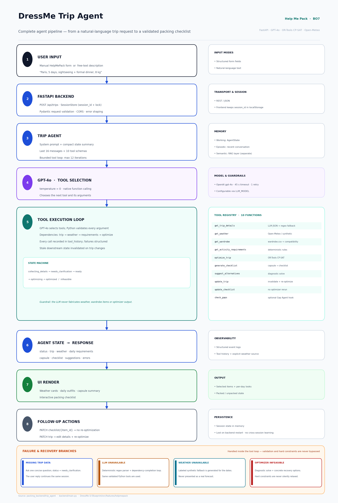

# DressMe Trip Agent — Agent Description and Implementation

> **Scope.** DressMe’s target architecture is a multi-agent system, but only one
> agent is implemented end-to-end today: the **Trip Agent** for **Help Me Pack
> (BO7)**. It is the first realized agent of the proposed architecture and the
> subject of this document. The broader eight-agent design is described in the
> project README and is still a proposal.

---

## 1. LLM Used

**OpenAI GPT-4o**, accessed through the Chat Completions API.

| Aspect | Implementation |
|---|---|
| Configuration | `LLM_MODEL=gpt-4o` in `.env`; default in `packing_backend/trip_agent/config.py:12` |
| API mode | Native function/tool calling, `tool_choice="auto"`, `temperature=0` (`llm.py:75-128`) |
| Structured extraction | `response_format={"type":"json_object"}`, with a retry without it for compatible providers (`llm.py:130-172`) |
| Timeouts | 45 s per request, one retry (`llm.py:68-72`) |
| Fallback | Deterministic regex parser and dependency-completion loop when the LLM or network is unavailable (`agent.py:256`) |

**Why GPT-4o.** The agent needs three capabilities at once: reliable native tool
calling, strict JSON output for trip extraction, and good instruction following
under negative constraints (“never invent missing data”). GPT-4o provides all
three, handles multilingual trip descriptions, and is deterministic enough at
`temperature=0` for a planning workflow. The model is configurable through
`LLM_MODEL`, so a compatible provider can replace it without changing the agent.

**Not used.** The LLM is not fine-tuned. The separate RAG layer uses
`sentence-transformers/all-MiniLM-L6-v2` for embeddings, not GPT-4o.

---

## 2. Memory

The agent uses three complementary memory types:

| Memory type | What is stored | Where | Lifetime |
|---|---|---|---|
| **Working memory** | Validated trip details, weather, wardrobe snapshot, daily requirements, optimization result, capsule, checklist, tool history, errors, status | `AgentState` Pydantic model (`schemas.py:375`) | One session |
| **Conversation / episodic memory** | Full user and assistant transcript; the last **16 messages** are injected into the LLM prompt | `state.messages`; `agent.py:176` | One session |
| **Session memory** | The `TripAgent` instance and its state, keyed by `session_id` and protected by a lock | In-memory `SessionStore` (`backend/main.py:89`) | Until backend restart |
| **Semantic / knowledge memory** | 14,574 embedded fashion-knowledge chunks from 38 PDFs; conversation records | `rag_backend/data/embedded_chunks.jsonl`, `conversations.sqlite3` | Persistent, but separate from the Trip Agent |
| **Client-side memory** | Current `session_id` so a page refresh can resume | Frontend `localStorage` | Browser |

The LLM also receives a compact **state summary** (`context_summary()`) containing
status, missing fields, weather source, optimization status and checklist counts.
There is **no long-term user-profile or wear-history memory yet**, and no
cross-session learning. Stale downstream state is explicitly invalidated when trip
details change (`tools.py:516-524`).

---

## 3. Actions

The agent is designed to perform the complete packing workflow:

1. **Understand the request** — parse free text or a structured form into
   destination, dates, duration, activities, occasions, dress code and luggage
   limit.
2. **Ask for missing information** — instead of inventing values, it asks one
   concise clarification question and pauses.
3. **Retrieve context** — fetch daily weather and load the user’s
   wardrobe/compatibility data.
4. **Translate context into requirements** — convert activities, weather and
   formality into optimizer-compatible daily constraints.
5. **Optimize the packing list** — run the CP-SAT solver to select a minimal set
   of maximally combinable items.
6. **Produce a trip capsule** — daily outfits, selected items, total clothing
   weight and optimization status.
7. **Generate a checklist** — every item starts `packed: false`.
8. **Update and re-optimize** — change dates, destination, activities, dress code
   or weight limit and regenerate the plan.
9. **Track packing** — mark items packed/unpacked without rerunning the
   optimizer.
10. **Diagnose failure** — when the result is `INFEASIBLE`, explain why and
    propose recovery options without silently relaxing hard constraints.
11. **Explain the result** — report status, item count, weight, weather source
    and checklist progress, grounded in tool output.
12. **Expose a gap-analysis hook** — optionally call a future Gap Agent.

It does **not** perform computer vision, purchase evaluation, outfit generation
outside a trip, or persistent user profiling.

---

## 4. Tools

The agent exposes **10 native function-calling tools**, defined in `tools.py:144`
and validated with Pydantic in `tools.py:380`.

| Tool | Function | Backing resource |
|---|---|---|
| `get_trip_details` | Extract/merge/validate trip fields; report missing fields | GPT-4o JSON extraction + deterministic regex fallback (`extraction.py:336`) |
| `get_weather` | Daily forecast for destination and dates | Open-Meteo geocoding + forecast API; labeled synthetic fallback (`weather.py:238`) |
| `get_wardrobe` | Load/filter wardrobe items and role coverage | `wardrobe.csv`, `compatibility.csv` via pandas (`wardrobe.py`) |
| `get_activity_requirements` | Build daily optimizer requirements | Deterministic rules (`requirements.py:159`) |
| `optimize_trip` | Solve the packing problem | **OR-Tools CP-SAT** (`optimizer.py:502`) |
| `generate_checklist` | Create the packing checklist from the capsule | Pydantic models (`schemas.py:321`) |
| `suggest_alternatives` | Diagnose infeasibility with a diagnostic solve | CP-SAT + wardrobe role analysis (`tools.py:772`) |
| `update_trip` | Edit trip details, invalidate stale state, optional re-optimization | `tools.py:918` |
| `update_checklist` | Mark an item packed/unpacked without re-solving | `tools.py:1043` |
| `check_gaps` | Optional Gap Agent interface | Injected `gap_checker` callable or mock (`backend/main.py:125`) |

**External services and infrastructure:** OpenAI API, Open-Meteo, OR-Tools,
pandas/CSV dataset, FastAPI, Pydantic, React/Vite frontend and browser
`localStorage`. The separate RAG layer also references **Supabase**,
Sentence-Transformers and SQLite.

---

## 5. Agent Pipeline



*Pipeline screenshot: input, API, agent loop, LLM, tools, state, UI output and
follow-up actions.*

### End-to-end flow

1. **User input** — the HelpMePack page accepts either the manual form or a
   natural-language description such as “Paris, 5 days, sightseeing and a formal
   dinner, 8 kg”.
2. **FastAPI backend** — `POST /api/trips` validates the request, creates or
   retrieves a session from the in-memory `SessionStore`, and locks the session
   while the agent runs.
3. **Trip Agent** — the agent builds a prompt from the system rules, a compact
   state summary, the last 16 messages and the 10 tool schemas.
4. **GPT-4o** — at `temperature=0`, the model chooses the next tool and produces
   its arguments. It does not compute the packing itself.
5. **Tool execution loop** — every argument is validated with Pydantic, Python
   enforces dependencies, and tool failures are returned as structured errors.
   The loop is bounded to 12 iterations.
6. **Agent state and response** — the agent returns a structured response with
   status, trip details, weather, daily requirements, capsule, checklist,
   suggestions and errors.
7. **UI render** — the frontend displays weather cards, extracted details, daily
   outfits, the capsule summary and an interactive checklist.
8. **Follow-up actions** — checklist updates call `PATCH
   /checklist/{item_id}` without re-optimizing; trip edits call `PATCH
   /trips/{session_id}` and can re-optimize.

### State machine

```text
collecting_details → needs_clarification → ready → optimizing
                                                   → optimized
                                                   → infeasible
```

### Failure and recovery branches

| Branch | Behaviour |
|---|---|
| **Missing trip data** | Ask one concise question; status becomes `needs_clarification`; the user reply continues the same session. |
| **LLM unavailable** | Use the deterministic regex parser and the dependency-completion loop; the same validated Python tools are executed. |
| **Weather unavailable** | Generate an explicitly labeled synthetic fallback; it is never presented as a real forecast. |
| **Optimizer INFEASIBLE** | Run a diagnostic solve, report the blocking constraints and propose concrete options; hard constraints are never silently relaxed. |

---

## 6. AI Techniques Used

| Technique | How it is used |
|---|---|
| **Agentic tool use / function calling** | GPT-4o chooses among 10 tools; Python validates arguments, enforces dependencies and executes deterministic operations. The loop is custom-built, not LangChain/LangGraph (`agent.py:165`). |
| **Advanced prompt engineering** | A 10-rule system prompt forbids inventing data, enforces tool order, requires clarification instead of guessing, forbids silent constraint relaxation and requires grounded final answers (`agent.py:19-43`). State summary and recent transcript are injected each turn. |
| **Structured output + schema validation** | Trip extraction returns JSON, then Pydantic validates and normalizes dates, activities, luggage limits and missing fields. Malformed output falls back to a deterministic parser. |
| **Hybrid neuro-symbolic reasoning** | The LLM handles language understanding, clarification and explanation; **OR-Tools CP-SAT** handles the combinatorial optimization. The LLM never computes or fabricates the packing result. |
| **Retrieval-Augmented Generation (RAG)** | A separate `rag_backend` ingests 38 fashion PDFs (6,600 pages, ~10.7M characters, 1,281 OCR pages), chunks them, tags categories/topics, embeds them with `all-MiniLM-L6-v2` and retrieves top-5 vector matches, with query rewriting and grounded answer generation. Evaluation: **Hit@5 = 0.9167, MRR = 0.8542, context precision = 0.7167** on 12 questions. It is currently a standalone knowledge layer, **not yet exposed as a Trip Agent tool**. |
| **Graceful degradation / guardrails** | Explicitly labeled synthetic weather, regex fallback extraction, a bounded agent loop, structured tool errors, dependency checks, no silent constraint relaxation, and a readable explanation layer. |
| **Evaluation** | Offline tests cover extraction, clarification, weather fallback, requirements, optimization, infeasibility recovery, trip updates and checklist updates; the RAG layer has retrieval metrics. |
| **Not used** | LLM fine-tuning, RLHF, autonomous multi-agent orchestration and real computer-vision integration. Those remain planned. |

### Why this combination

The LLM is good at interpreting messy language and explaining decisions, but it is
not a reliable constraint solver. The architecture therefore keeps the LLM on the
**language and orchestration** side and delegates weather, wardrobe lookup,
requirement generation and combinatorial packing to **deterministic tools**. This
gives the agent conversational flexibility without allowing it to hallucinate a
packing result or silently violate the luggage limit.

---

## 7. Implementation Status and Limitations

**Implemented**

- Trip Agent, tool registry, OpenAI integration, Open-Meteo integration with
  synthetic fallback, requirements generation, CP-SAT optimizer adapter,
  capsule/checklist, FastAPI endpoints, React HelpMePack integration and tests.
- RAG artifacts and evaluation metrics (chunks, embeddings, quality report,
  evaluation results, conversation database).

**Still limited**

- The wardrobe and compatibility data are synthetic.
- Sessions are in-memory and are lost on backend restart.
- There is no authentication or persistent user profile.
- The RAG backend’s source modules are not present in the current working tree;
  only generated artifacts and bytecode remain, so the RAG layer is documented as
  a separate knowledge component rather than a wired Trip Agent tool.
- The computer-vision model referenced in `.env` (`models/dressme_best.pt`) is
  not wired into this agent.
- The full eight-agent DressMe architecture is still a proposal.

---

## 8. Key Source Files

| File | Responsibility |
|---|---|
| `packing_backend/trip_agent/agent.py` | Custom LLM tool-calling loop, fallback loop and response composition |
| `packing_backend/trip_agent/tools.py` | Tool schemas, Pydantic validation, execution and state invalidation |
| `packing_backend/trip_agent/llm.py` | OpenAI chat-completions wrapper, function calling and JSON extraction |
| `packing_backend/trip_agent/extraction.py` | LLM extraction, deterministic regex fallback and date/activity parsing |
| `packing_backend/trip_agent/weather.py` | Open-Meteo geocoding/forecast and labeled synthetic fallback |
| `packing_backend/trip_agent/requirements.py` | Activity/weather/occasion to optimizer-compatible daily requirements |
| `packing_backend/trip_agent/optimizer_adapter.py` | Calls the CP-SAT optimizer and builds the capsule |
| `packing_backend/optimizer.py` | OR-Tools CP-SAT packing optimization |
| `packing_backend/trip_agent/schemas.py` | Pydantic state, trip, weather, capsule and checklist models |
| `backend/main.py` | FastAPI app, in-memory sessions and REST endpoints |
| `DressMe UI Blueprint/src/api/tripAgent.ts` | Frontend API client |
| `DressMe UI Blueprint/src/features/helpmepack/HelpMePack.tsx` | HelpMePack UI |
| `docs/agent-pipeline.png` | Rendered pipeline screenshot |
| `docs/agent-pipeline.mmd` | Editable Mermaid source for the pipeline diagram |
