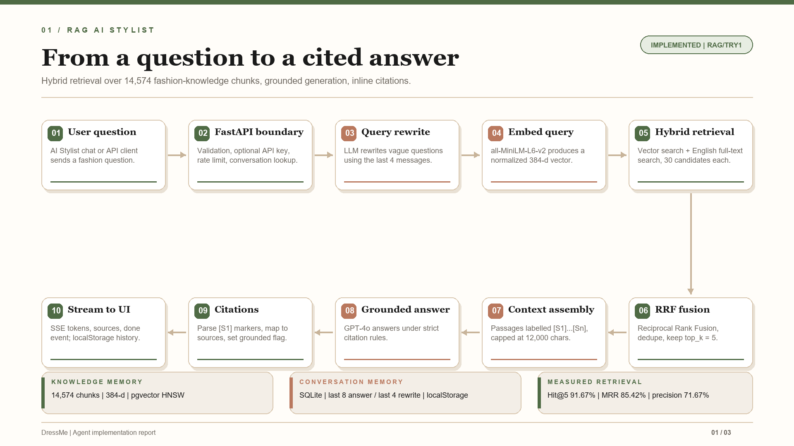
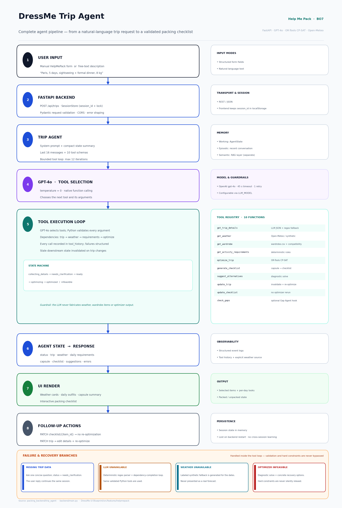
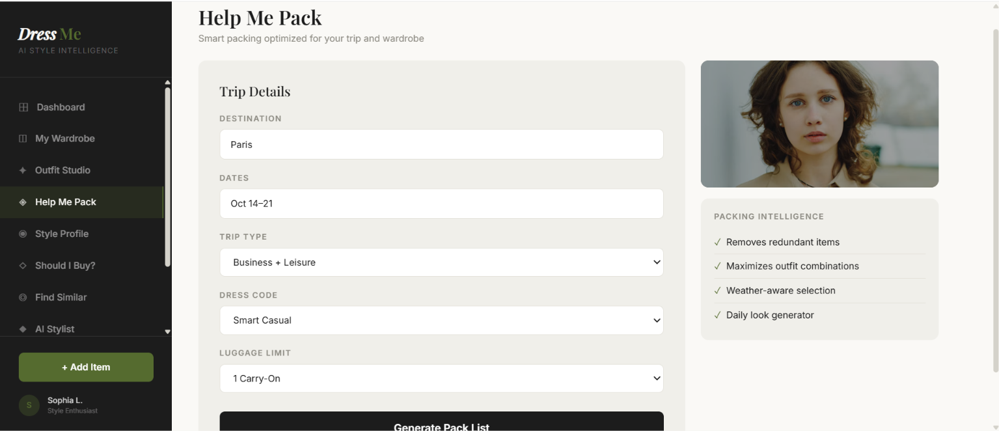
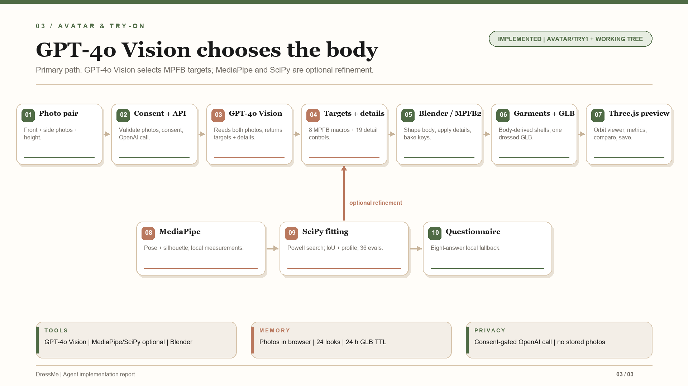
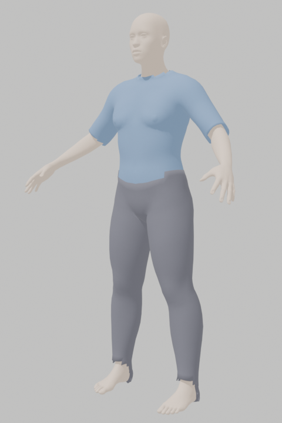

# DressMe — Implemented Agent Prototypes

**Advanced Data Science Project · Agent Implementation Report**

This report documents three implemented prototypes in the DressMe repository:

| # | Idea | Branch | Evidence |
|---|---|---|---|
| 01 | RAG AI Stylist | `rag/try1` (`5f7f6b4`) | `rag_backend/`, `supabase/`, AI Stylist UI |
| 02 | Trip Agent / Help Me Pack | `helpmepack/try1` (`8d90269`) | `packing_backend/trip_agent/`, HelpMePack UI |
| 03 | Avatar & Try-On | `avatar/try1` (`22eebcb`) + current working tree | `backend/`, Blender/MPFB2, MediaPipe, Three.js |

The third section also covers the uncommitted GPT-4o Vision avatar-estimation flow, optional MediaPipe/SciPy refinement, and MPFB detail-target work currently present in the working tree (`backend/vision.py`, `backend/optimizer.py`, `backend/mpfb_details.py`, `backend/mpfb_targets.json`, `backend/body_scan.py`, `pose.ts`, `bodyPhotos.ts`, `silhouette.ts`, `bodyDetails.ts`, `questionnaire.ts`, and their tests). That work is explicitly labelled as current, uncommitted prototype work.

> **What is real.** Each section is based on code and artifacts that exist in the repository. The report separates implemented behaviour from limitations and future work. No API keys or secrets are included.

**Companion deck:** [`agent-report.pptx`](agent-report.pptx) - 30 slides, 16:9, matching the DressMe design language. The first three slides are the LLM agent overview, restyled to match the report theme without changing their structure or wording.  
**Pipeline assets:** [`agents-report-assets/`](agents-report-assets/).

---

## Executive summary

DressMe is a smart-wardrobe ecosystem for the Tunisian market. The repository contains three different kinds of intelligence:

1. **A grounded knowledge agent.** The RAG AI Stylist answers fashion questions from a curated book corpus and returns inline citations. It uses hybrid retrieval over 14,574 chunks.
2. **A task-oriented planning agent.** The Trip Agent interprets a trip request, calls deterministic tools, fetches weather, runs a CP-SAT packing optimizer, and produces a trip capsule and checklist.
3. **A visual body and try-on agent.** The Avatar pipeline sends a front/side photo pair to GPT-4o Vision, which chooses the MPFB body parameters; optional MediaPipe and SciPy fitting can refine the result. Blender regenerates the body-shaped avatar and builds garments from the generated surface for 3D try-on.

The three prototypes deliberately use different intelligence strategies. The RAG agent is language-and-retrieval centric. The Trip Agent is neuro-symbolic: the LLM orchestrates, while Python and OR-Tools compute. The Avatar pipeline uses GPT-4o Vision for parameter selection, deterministic geometry for generation, and optional local vision/SciPy refinement.

---

## 1. RAG AI Stylist

**Branch:** `rag/try1`  
**Role in DressMe:** grounded fashion-knowledge layer behind the AI Stylist.  
**Primary entry points:** `rag_backend/app.py`, `rag_backend/rag/rag_service.py`, `rag_backend/rag/retriever.py`.

### 1.1 LLM used

The answer and query-rewrite model is selected through `LLM_MODEL` and called through an OpenAI-compatible Chat Completions client (`rag_backend/rag/llm_client.py`). The repository environment currently sets `LLM_MODEL=gpt-4o`; the tracked `.env.example` uses `gpt-4o-mini` as a cheaper default. The model is therefore configurable rather than hard-coded.

| Aspect | Implementation |
|---|---|
| Provider | OpenAI-compatible API (`LLM_API_KEY` or `OPENAI_API_KEY`, optional `LLM_BASE_URL`) |
| Current repo model | `gpt-4o` |
| Example/default model | `gpt-4o-mini` in `.env.example` |
| Answer temperature | `0.2` (`LLM_TEMPERATURE`) |
| Rewrite temperature | `0.0` |
| Max answer tokens | `900` |
| Timeout / retries | 45 s, 2 retries with exponential backoff |
| Embedding model | `sentence-transformers/all-MiniLM-L6-v2`, 384 dimensions |

**Why this choice.** The agent needs two distinct behaviours from the same model: a cheap, deterministic query rewrite, and a careful grounded answer that respects retrieved evidence. GPT-4o-class models follow negative constraints well (“do not invent citations”, “say when the context is insufficient”), handle multilingual user questions, and support streaming. The low answer temperature keeps citations and advice stable. The embedding model is deliberately separate: retrieval quality is optimized with a small sentence-transformer rather than an LLM embedding.

No fine-tuning is used.

### 1.2 Memory

The RAG agent uses four memory layers:

| Memory layer | What is stored | Where | Lifetime |
|---|---|---|---|
| Conversation memory | User/assistant messages, sources, citations, rewritten query | SQLite in WAL mode (`conversations.py`) | Persistent |
| Prompt context | Last 8 messages for answering, last 4 for query rewriting | `rag_service.py`, `query_rewrite.py` | Per request |
| Knowledge memory | 14,574 embedded chunks from 38 fashion PDFs | Supabase Postgres + pgvector | Persistent |
| Client memory | Conversation ID and rendered chat messages | Browser `localStorage` (`dressme.chat.v1`) | Until cleared |

The SQLite schema stores conversations and messages with source metadata and rewritten queries. The browser restores the conversation after a refresh. The knowledge base is separate from user data: the RAG does **not** retrieve the user's wardrobe, wear log, profile, weather, or purchase history yet.

This is a deliberate boundary: the current agent is a fashion-knowledge assistant, not yet a personal-wardrobe assistant.

### 1.3 Actions

The implemented agent can:

1. Accept a natural-language fashion question (1–2,000 characters).
2. Rewrite vague or context-dependent questions into retrieval-friendly queries.
3. Embed the rewritten query with the same 384-dimensional model used at ingestion.
4. Run vector search and English full-text search in parallel.
5. Fuse both result lists with Reciprocal Rank Fusion.
6. Filter weak matches by a minimum cosine similarity.
7. Build a source-labelled context block (`[S1]`, `[S2]`, ...) capped at 12,000 characters.
8. Generate an answer that cites source-backed claims.
9. Return deduplicated sources, citations, the rewritten query, and a grounded flag.
10. Stream the answer token-by-token over Server-Sent Events.
11. Create, read, and delete conversation histories.
12. Refuse to answer when retrieval has no credible evidence.

The “no information” path is important: if retrieval returns nothing, the service returns a fixed answer with `grounded: false` instead of letting the model improvise.

### 1.4 Tools

| Tool / service | Purpose |
|---|---|
| FastAPI | `/ask`, `/ask/stream`, `/conversations`, `/health` |
| OpenAI Python SDK | Query rewriting and answer generation |
| Supabase Postgres + pgvector | Storage of 14,574 chunks and 384-dimensional embeddings |
| Supabase RPCs | `match_knowledge_chunks`, `search_knowledge_chunks` |
| SentenceTransformers | Query and document embeddings |
| PyMuPDF (`fitz`) | PDF text extraction |
| Tesseract OCR | Fallback for scanned pages (1,281 pages OCR’d) |
| SQLite | Conversation and message persistence |
| Server-Sent Events | Streaming `sources`, `token`, `done`, and `error` events |
| React/Vite AI Stylist | Chat UI, source display, `localStorage` restore |
| Pytest + Ruff + GitHub Actions | Retrieval, API, quality, conversation and metric tests |

The ingestion pipeline is also a set of tools: extraction cache, quality report, chunker, embedder, indexer, and `verify_setup.py`.

### 1.5 Agent pipeline



*Pipeline diagram generated from the implementation in `rag_backend/`.*

The production path is:

1. **Input.** The user asks a question in the AI Stylist.
2. **API boundary.** FastAPI validates the request, checks the optional `X-API-Key`, applies a 30-requests/minute sliding-window limit, and resolves or creates a conversation.
3. **Query rewrite.** The LLM rewrites the question using the last four messages. Failure falls back to the original question.
4. **Embedding.** The rewritten query is embedded with `all-MiniLM-L6-v2`.
5. **Hybrid retrieval.** Vector search and Postgres full-text search each return up to 30 candidates.
6. **Fusion.** Reciprocal Rank Fusion combines the lists (`1 / (60 + rank)`), deduplicates by `chunk_id`, and keeps the top `top_k` (default 5).
7. **Context assembly.** Passages are labelled `[S1]`...`[Sn]`, with source, page, title and section metadata, capped at 12,000 characters.
8. **Grounded generation.** GPT-4o answers under a six-rule system prompt that requires citations and forbids invented facts or citations.
9. **Citation parsing.** Only markers actually present in the answer become citations. `grounded` is true when at least one valid citation exists.
10. **Response.** The API returns the answer, sources, citations, conversation ID, rewritten query, and usage. The UI renders sources and stores the conversation locally.

The repository includes a retrieval evaluation on a 12-question golden set:

| Metric | Result |
|---|---:|
| Hit@5 | 91.67% |
| MRR@5 | 85.42% |
| Context precision | 71.67% |

Known weak spots are colour-harmony retrieval and low ranking for some work-clothes questions.

### 1.6 AI techniques used

| Technique | How it is used |
|---|---|
| **Retrieval-Augmented Generation (RAG)** | Answers are generated from retrieved book passages rather than model memory alone. |
| **Hybrid retrieval** | Cosine vector search plus Postgres full-text search, so semantic and keyword matches both contribute. |
| **Reciprocal Rank Fusion** | Merges the two ranked lists without needing a learned reranker. |
| **LLM query rewriting** | Converts vague conversational questions into specific search queries using recent context. |
| **Grounding and inline citations** | The prompt requires `[S1]`-style markers; citations are parsed and mapped back to source metadata. |
| **Extractive ingestion with OCR** | PyMuPDF extracts native text; Tesseract recovers low-text scanned pages. |
| **Metadata enrichment** | Each chunk stores source, page, title, author, section, category, topics, OCR flag, content hash, and embedding version. |
| **Offline evaluation** | Hit@k, MRR@k, context precision, citation accuracy, and groundedness on a golden question set. |
| **Graceful refusal** | A similarity floor and empty-retrieval path prevent unsupported answers. |

**Not used:** fine-tuning, a cross-encoder reranker, metadata filters at query time, multilingual retrieval, personal-wardrobe retrieval, and multi-agent orchestration.

### 1.7 Limitations

- The corpus and full-text search are English-only.
- The agent is not wardrobe-aware; it cannot answer “what should I wear from my own closet?”
- Chunking is page-scoped and character-based, so semantic units can split.
- No cross-encoder reranker and no query-time metadata filters.
- `grounded` is heuristic: it checks that a citation exists, not that the cited text supports the claim.
- The API key is client-bundled in the demo UI; production needs a server-side proxy.
- SQLite conversations and in-memory rate limiting assume a single API instance.
- The Docker healthcheck makes a paid LLM call every 30 seconds.

---

## 2. Trip Agent / Help Me Pack

**Branch:** `helpmepack/try1`  
**Role in DressMe:** planning agent for BO7, “Help Me Pack”.  
**Primary entry points:** `packing_backend/trip_agent/agent.py`, `tools.py`, `backend/main.py`, `HelpMePack.tsx`.

### 2.1 LLM used

**OpenAI GPT-4o** is the default model (`DEFAULT_MODEL = "gpt-4o"` in `packing_backend/trip_agent/config.py`), accessed through native Chat Completions function calling.

| Aspect | Implementation |
|---|---|
| Model | `gpt-4o`, override with `LLM_MODEL` |
| Tool use | Native function calling, `tool_choice="auto"` |
| Temperature | `0` |
| Structured extraction | `response_format={"type": "json_object"}`, with one plain retry for compatible providers |
| Timeout / retries | 45 s, one retry |
| Agent loop limit | 12 iterations |
| Fallback | Deterministic regex parser and dependency-completion loop when the LLM is unavailable |

**Why GPT-4o.** The agent must do three things at once: interpret messy multilingual trip descriptions, choose among ten tools with valid JSON arguments, and explain the result without inventing data. GPT-4o handles native tool calling and strict JSON well, and `temperature=0` makes the planning workflow repeatable. The model is configurable, so a compatible provider can replace it.

No fine-tuning is used.

### 2.2 Memory

| Memory type | What is stored | Where | Lifetime |
|---|---|---|---|
| Working memory | Validated trip, weather, wardrobe snapshot, daily requirements, optimizer result, capsule, checklist, tool history, errors, status | `AgentState` Pydantic model | One session |
| Conversation memory | User and assistant transcript; last 16 messages injected into the prompt | `state.messages` | One session |
| Session memory | `TripAgent` instance keyed by `session_id`, protected by a lock | In-memory `SessionStore` in `backend/main.py` | Until backend restart |
| Client memory | Current `session_id` | Browser `localStorage` | Until cleared |
| Separate knowledge memory | Fashion-knowledge chunks and RAG conversations | `rag_backend/` | Persistent, not wired into this agent |

The agent also injects a compact state summary (status, missing fields, weather source, optimization status, checklist counts) into each LLM turn. Stale downstream state is explicitly invalidated when trip details change. There is no long-term user profile or wear-history memory and no cross-session learning.

### 2.3 Actions

The Trip Agent implements the complete packing workflow:

1. Parse free text or a structured form into destination, dates, duration, activities, occasions, dress code, and luggage limit.
2. Ask one concise clarification question when fields are missing, instead of inventing values.
3. Fetch daily weather for the destination and dates.
4. Load the user’s wardrobe and compatibility data.
5. Translate weather, activities, and formality into optimizer-compatible daily requirements.
6. Run the CP-SAT optimizer to select a minimal set of maximally combinable items.
7. Produce a trip capsule with daily outfits, selected items, total clothing weight, and optimization status.
8. Generate a checklist where every item starts `packed: false`.
9. Update trip details and re-optimize when the user changes the plan.
10. Mark items packed or unpacked without re-running the optimizer.
11. Diagnose `INFEASIBLE` results and propose recovery options without silently relaxing hard constraints.
12. Explain the result using tool output: status, item count, weight, weather source, and checklist progress.
13. Optionally call a future Gap Agent hook.

It does not perform computer vision, purchase evaluation, outfit generation outside a trip, or persistent profiling.

### 2.4 Tools

The agent exposes ten native function-calling tools:

| Tool | Function | Backing resource |
|---|---|---|
| `get_trip_details` | Extract, merge, validate trip fields and report missing fields | GPT-4o JSON extraction + regex fallback |
| `get_weather` | Daily forecast | Open-Meteo geocoding + forecast API |
| `get_wardrobe` | Load and filter wardrobe items and role coverage | `wardrobe.csv`, `compatibility.csv` via pandas |
| `get_activity_requirements` | Build daily optimizer requirements | Deterministic rules in `requirements.py` |
| `optimize_trip` | Solve the packing problem | OR-Tools CP-SAT |
| `generate_checklist` | Create the checklist from the capsule | Pydantic models |
| `suggest_alternatives` | Diagnose infeasibility with a diagnostic solve | CP-SAT + wardrobe role analysis |
| `update_trip` | Edit trip details, invalidate stale state, optionally re-optimize | `tools.py` |
| `update_checklist` | Mark packed/unpacked without re-solving | `tools.py` |
| `check_gaps` | Optional Gap Agent interface | Injected checker or mock |

External services and infrastructure: OpenAI API, Open-Meteo, OR-Tools CP-SAT, pandas/CSV, FastAPI, Pydantic, React/Vite, and browser `localStorage`.

### 2.5 Agent pipeline



*Pipeline screenshot from the Help Me Pack branch (`docs/agent-pipeline.png`).*

The implemented HelpMePack form:



*Actual Help Me Pack UI: destination, dates, trip type, dress code, luggage limit, and the generate action.*

End-to-end flow:

1. **User input.** Manual form or free text, e.g. “Paris, 5 days, sightseeing and a formal dinner, 8 kg”.
2. **FastAPI.** `POST /api/trips` validates the request, creates or retrieves a session, and locks it while the agent runs.
3. **Trip Agent.** Builds a prompt from the system rules, compact state summary, last 16 messages, and ten tool schemas.
4. **GPT-4o.** Chooses the next tool and produces arguments; it does not compute the packing itself.
5. **Tool loop.** Pydantic validates every argument, Python enforces dependencies, tool failures become structured errors, and the loop is bounded to 12 iterations.
6. **State and response.** The agent returns trip details, weather, daily requirements, capsule, checklist, suggestions, and errors.
7. **UI render.** Weather cards, extracted details, daily outfits, capsule summary, and an interactive checklist.
8. **Follow-up.** Checklist updates call `PATCH /checklist/{item_id}` without re-optimizing; trip edits call `PATCH /trips/{session_id}` and can re-optimize.

Failure branches:

| Branch | Behaviour |
|---|---|
| Missing trip data | Ask one concise question; status becomes `needs_clarification`. |
| LLM unavailable | Deterministic regex parser and dependency-completion loop. |
| Weather unavailable | Explicitly labelled synthetic fallback, never presented as real. |
| Optimizer `INFEASIBLE` | Diagnostic solve, blocking constraints, concrete options; no silent relaxation. |

### 2.6 AI techniques used

| Technique | How it is used |
|---|---|
| **Agentic tool use / function calling** | GPT-4o selects among ten tools; Python validates and executes deterministic operations. The loop is custom-built, not LangChain/LangGraph. |
| **Advanced prompt engineering** | A ten-rule system prompt forbids invented data, enforces tool order, requires clarification, forbids silent constraint relaxation, and requires grounded final answers. |
| **Structured output + schema validation** | Trip extraction returns JSON; Pydantic validates and normalizes dates, activities, limits, and missing fields. |
| **Hybrid neuro-symbolic reasoning** | The LLM handles language and orchestration; CP-SAT handles the combinatorial optimization. The LLM never fabricates the packing result. |
| **Retrieval-Augmented Generation (RAG)** | The separate RAG layer is documented in section 1. It is not yet exposed as a Trip Agent tool. |
| **Graceful degradation / guardrails** | Labelled synthetic weather, regex fallback, bounded loop, structured tool errors, dependency checks, no silent constraint relaxation. |
| **Evaluation** | Offline tests cover extraction, clarification, weather fallback, requirements, optimization, infeasibility, updates, and checklist updates. |

**Not used:** LLM fine-tuning, RLHF, autonomous multi-agent orchestration, and real computer-vision integration.

### 2.7 Limitations

- Wardrobe and compatibility data are synthetic.
- Sessions are in-memory and disappear on backend restart.
- No authentication or persistent user profile.
- The RAG layer is not a wired Trip Agent tool.
- The computer-vision model referenced in `.env` is not wired into this agent.
- The full eight-agent DressMe architecture is still a proposal.

---

## 3. Avatar & Try-On Agent

**Branch:** `avatar/try1` plus current working tree  
**Role in DressMe:** body-aware visual try-on and outfit preview.  
**Primary entry points:** `backend/main.py`, `backend/vision.py`, `backend/blender/generate_avatar.py`, `backend/blender/generate_dressed_avatar.py`, `CustomizeAvatar.tsx`, `TryOnStudio.tsx`.

### 3.1 LLM used

The primary avatar-estimation path is **GPT-4o Vision** through `backend/vision.py`, exposed as `POST /api/body/vision`. The user uploads a front photo, a side photo, and a height, ticks the consent box, and presses **Create my avatar**. The backend sends both photos to the OpenAI Chat Completions API and asks the model to choose MPFB avatar parameters from the relative body shape it sees.

The model returns a JSON object with:

- `body_shape` and `confidence`,
- photo-quality notes and posture observations,
- `targets` for the eight MPFB macro parameters (`gender`, `age`, `muscle`, `weight`, `proportions`, `cupsize`, `firmness`, `legLength`),
- `detail_values` for the 19 advanced detail controls,
- short caveats about clothing, pose, camera angle, or lighting.

The backend clamps every value, rejects unknown keys, and returns the cleaned result. The frontend applies the targets and detail values, then calls `POST /api/avatar/generate`. The prompt explicitly forbids centimetres, identity claims, and sensitive attributes; `0.5` is neutral for targets and `0.0` is neutral for details. This makes the model a **parameter chooser**, not a tape measure.

Model selection is `OPENAI_VISION_MODEL`, falling back to `LLM_MODEL`, then `gpt-4o`. The request uses temperature `0.2`, JSON-object output, high image detail, and a 90 s timeout.

The current working tree still contains two optional advanced paths:

- **Local MediaPipe analysis** (pose + silhouette) behind ?Advanced photo tools (optional)?.
- **SciPy silhouette fitting** behind ?Refine with silhouette fitting?, which runs a Powell search over 15 macro/detail controls and scores rendered masks with IoU and width-profile error.

The questionnaire remains a local fallback. No fine-tuning is used.

| Path | Role | Network |
|---|---|---|
| GPT-4o Vision | Primary body-parameter estimation from front + side photos | OpenAI, after explicit consent |
| Local MediaPipe | Optional pose + silhouette measurements | None; photos stay in the browser |
| SciPy fitting | Optional silhouette refinement after local analysis | Local backend + Blender |
| Questionnaire | Deterministic anthropometric fallback | None |
| Avatar generation | Blender 5.4 + MPFB2 macro and detail targets | Local backend |
| Garment generation | Procedural geometry from the actual body mesh | Local backend |

### 3.2 Memory

| Memory type | What is stored | Where | Lifetime |
|---|---|---|---|
| UI working memory | Front/side photos, vision result, targets, detail sliders, generated URL, history | React state | Page session |
| Photo pair | Front and side images as browser object URLs | Browser memory | Until replaced or page closed |
| Vision result | Body shape, confidence, observations, targets, detail values, notes | React state; not persisted server-side | Request |
| Saved looks | Up to 24 looks with label, garment IDs, wardrobe IDs, timestamp | Browser `localStorage` (`dressme.savedLooks.v1`) | Persistent |
| Backend job state | One active Blender job, parameter JSON, details JSON, temp GLB, job lock | `backend/main.py`, `backend/temp/` | Process / job |
| Optimizer job state | Async job, evaluation progress, best score, fitted targets/details | In-memory `_opt_jobs`, `backend/temp/opt_<id>/` | Process / job cleanup |
| Generated assets | `avatar_<jobId>.glb` files | `public/models/generated/` | 24 h TTL |
| Detail manifest | 128 whitelisted MPFB detail targets across torso, legs, arms, hips, stomach, etc. | `backend/mpfb_targets.json` | Versioned in repo |
| Garment catalog | 10 garments, 5 slots, geometry hints | `garments.json` shared by frontend and Blender | Versioned in repo |

There is no user account, no durable body profile, and no cross-session wear history. The primary GPT-4o Vision path sends the two photos to OpenAI only after explicit consent; DressMe does not store them server-side. The local MediaPipe path never uploads images. Generated GLBs are cleaned after 24 hours.

### 3.3 Actions

The avatar/try-on agent can:

**Primary flow**

1. Accept a front photo, a side photo, and a declared height.
2. Require explicit consent before sending the photos to OpenAI.
3. Call GPT-4o Vision and receive body shape, confidence, observations, 8 macro targets, and 19 detail values.
4. Clamp and apply the returned MPFB targets and detail sliders.
5. Submit a validated generation request to FastAPI.
6. Run Blender headless with MPFB2 to shape the body.
7. Apply detail targets after the macro shape, then apply the torso/leg post-process.
8. Build fitted garments from the generated body surface.
9. Export avatar + garments as one GLB and validate its magic bytes and size.
10. Serve the GLB from the Vite public folder.
11. Render the 3D result with rotate and zoom.
12. Compare the previous look, reuse a selection, and save a look.

**Optional advanced flow**

13. Run local MediaPipe pose + silhouette analysis for measurements and side-depth hints.
14. Run the SciPy silhouette-fitting job: Powell search over 15 controls, Blender mask rendering, IoU + width-profile scoring, up to 36 evaluations.
15. Use the eight-question local estimator when photos are unavailable.
16. Run one closed-loop correction pass: compare achieved ratios with the target, nudge `muscle`/`legLength`, and regenerate once.

The garment catalogue is slot-based: one item per slot, a dress replaces top + bottom, and outerwear layers over a top.

### 3.4 Tools

| Tool / service | Purpose |
|---|---|
| OpenAI GPT-4o Vision (primary) | Body-shape observations and MPFB parameter selection |
| MediaPipe Pose Landmarker (optional) | Pose landmarks, visibility, frontality, quality |
| MediaPipe Image Segmenter (optional) | Person silhouette from `selfie_segmenter.tflite` |
| SciPy + NumPy + Pillow (optional) | Silhouette fitting: Powell search, mask I/O, IoU, width profiles |
| FastAPI | `/api/health`, `/api/body/status`, `/api/body/questionnaire`, `/api/body/measurements`, `/api/body/vision`, `/api/avatar/generate`, `/api/avatar/optimize` |
| Pydantic | Request validation and bounds |
| Blender 5.4 headless | Runs the avatar and dressed-avatar scripts; renders optimizer masks |
| MPFB2 | Macro body parameters, detail targets, shape-key baking, GLB export |
| `bpy` / `bmesh` | Mesh manipulation, vertex classification, garment shells |
| Three.js + react-three-fiber + drei | 3D preview, lighting, shadows, orbit controls |
| React + Vite | Customize and Try-On UI |
| `httpx` | OpenAI Vision client with timeout handling |
| Pytest | Validation, GLB, body-scan, vision, detail-target, and optimizer tests |

The frontend and Blender share `garments.json`, so ids, slots, labels, colours, and geometry hints cannot drift apart. The detail manifest is validated by `mpfb_details.py`, which rejects arbitrary target names and caps details at 128.

### 3.5 Agent pipeline



*Pipeline diagram generated from the current implementation in `backend/` and the working tree.*

**Primary path**

1. **Input.** Front + side photos with a declared height.
2. **Consent and API.** The UI requires consent; FastAPI validates photo type/size and accepts the vision request.
3. **GPT-4o Vision.** The model reads both photos and returns body shape, confidence, observations, 8 macro targets, and 19 detail values.
4. **Targets and details.** The frontend clamps the values and applies them to the MPFB sliders and advanced detail controls.
5. **API validation.** FastAPI validates targets, details, and outfit slot rules, and acquires a single-job lock.
6. **Blender body generation.** `generate_avatar.py` sets MPFB macros, reapplies macro details, loads detail targets, applies `legLength`, bakes shape keys, and exports a GLB.
7. **Dressed generation.** `generate_dressed_avatar.py` reads joint-cube landmarks, classifies skin vertices to anatomical segments, builds garment shells from the body surface, offsets them along normals, solidifies them, assigns materials, and exports one GLB.
8. **Validation and serving.** The backend checks GLB magic bytes and size, moves it into `public/models/generated/`, and returns the URL, applied details, and achieved metrics.
9. **3D preview.** Three.js loads the GLB, normalizes only implausible scales, and shows height in metres.
10. **Closed-loop correction.** The frontend compares desired and achieved ratios and triggers one regeneration if needed.

**Optional refinement path**

- MediaPipe Pose + Image Segmenter extract local measurements and side-depth hints.
- SciPy Powell fitting adjusts 15 controls, rendering front/side masks for each evaluation and scoring IoU + width-profile error.
- The questionnaire provides a deterministic fallback when photos are unavailable.

Actual rendered prototype output:



*Actual Blender render of `public/models/dressed_avatar.glb` using `backend/blender/render_preview.py`.*

### 3.6 AI techniques used

| Technique | How it is used |
|---|---|
| **Vision-language parameter selection** | GPT-4o Vision reads front + side photos and chooses MPFB macro targets plus detail values. |
| **Structured output and schema validation** | The model returns JSON; the backend clamps values, rejects unknown keys, and enforces bounds. |
| **Pose estimation (optional)** | MediaPipe landmarks, visibility, and view-specific frontality checks support local measurements. |
| **Image segmentation (optional)** | MediaPipe selfie segmenter extracts the silhouette used for width/depth measurements. |
| **Silhouette fitting optimization (optional)** | SciPy Powell search over 15 controls; each evaluation renders masks and scores IoU + width-profile error. |
| **Procedural garment generation** | Garments are built from the actual body mesh, not imported assets. Vertices are classified to anatomical segments, kept by region, offset along normals, and solidified. |
| **Closed-loop correction** | Achieved body ratios are compared with the target; `muscle` and `legLength` are nudged and the avatar is regenerated once. |
| **Guardrails** | Consent gating, photo validation, value clamping, invalid garment combinations, oversized uploads, invalid detail names, and invalid GLBs are rejected. |

**Not used for geometry:** fine-tuning, skeletal skinning, morph targets, cloth simulation, and persistent body profiles. The exported GLB is a static mesh with baked shape keys and shared topology.

### 3.7 Limitations

- GPT-4o Vision produces relative parameter estimates, not measurements; clothing, pose, lighting, and camera angle affect the result.
- The primary photo path depends on an OpenAI API key, network, consent, and quota.
- Local MediaPipe and SciPy fitting are optional and operate as a second pass.
- Silhouette fitting runs Blender many times, takes roughly 3-5 minutes, and defaults to 36 evaluations.
- The exported avatar has no skeleton, no morph targets, and no runtime skinning.
- Garments are procedural shells, not production cloth simulation.
- The wardrobe-to-garment mapping uses a small catalogue of 10 garments across 5 slots.
- Generated GLBs are cleaned after 24 hours; there is no durable user avatar profile.
- The backend is local-only (`127.0.0.1`) and has no authentication.

## 4. Cross-agent comparison

| Dimension | RAG AI Stylist | Trip Agent | Avatar / Try-On |
|---|---|---|---|
| Primary intelligence | Retrieval + grounded generation | LLM orchestration + CP-SAT | Vision-language selection + geometry |
| LLM | GPT-4o (configurable) | GPT-4o (configurable) | GPT-4o Vision (primary) |
| Core memory | SQLite conversations + pgvector corpus | AgentState + in-memory sessions | React state + localStorage + file cache |
| Main external service | Supabase / OpenAI | OpenAI / Open-Meteo | OpenAI / Blender (+ MediaPipe optional) |
| Key AI technique | Hybrid RAG with citations | Native tool calling + neuro-symbolic optimization | VLM parameter selection + procedural garments |
| Output | Cited answer + sources | Trip capsule + checklist | Body-shaped GLB + 3D try-on |
| Evaluation | Golden-set retrieval metrics | Offline tool/optimizer tests | Validation tests + rendered previews |
| Status | Implemented | Implemented | Implemented; GPT-4V flow uncommitted |

### Why the differences are intentional

The three prototypes answer different questions:

- The RAG agent must **know** something and show its evidence.
- The Trip Agent must **decide and compute** under hard constraints.
- The Avatar pipeline must **construct** something geometrically correct.

Using an LLM for all three would make the system less reliable. The architecture keeps the LLM where language and explanation matter, and uses deterministic tools where correctness matters.

---

## 5. Prototype evidence and reproduction

### 5.1 Evidence map

| Area | Evidence |
|---|---|
| RAG | `rag_backend/app.py`, `rag/rag_service.py`, `rag/retriever.py`, `evaluation/`, `tests/`, Supabase migrations |
| Trip Agent | `packing_backend/trip_agent/`, `packing_backend/optimizer.py`, `backend/main.py`, `HelpMePack.tsx`, `docs/agent-pipeline.png` |
| Avatar | `backend/main.py`, `backend/blender/`, `pose.ts`, `silhouette.ts`, `bodyPhotos.ts`, `avatarApi.ts`, `CustomizeAvatar.tsx`, `TryOnStudio.tsx`, `garments.json` |
| Current uncommitted GPT-4V capture work | `backend/vision.py`, `backend/optimizer.py`, `backend/mpfb_details.py`, `backend/mpfb_targets.json`, `backend/tests/test_vision.py`, `backend/tests/test_mpfb_details.py`, `bodyPhotos.ts`, `silhouette.ts`, `bodyDetails.ts`, `questionnaire.ts` |

### 5.2 How to run

**RAG API**

```powershell
cd rag_backend
python -m uvicorn app:app --host 127.0.0.1 --port 8000
```

**Trip Agent**

```powershell
cd backend
uvicorn main:app --host 127.0.0.1 --port 8000
```

Then open the HelpMePack page in the Vite app.

**Avatar backend**

```powershell
cd backend
uvicorn main:app --host 127.0.0.1 --port 8000
```

The avatar generator needs the Blender path and `avatar.blend` configured in `backend/README.md`. The GPT-4 Vision route is the primary avatar-estimation path and uses `OPENAI_API_KEY` (and optionally `OPENAI_VISION_MODEL`). The optional local MediaPipe and silhouette-fit paths remain available as advanced tools; the fit is `POST /api/avatar/optimize` followed by `GET /api/avatar/optimize/{job_id}`.

**UI**

```powershell
cd "DressMe UI Blueprint"
pnpm dev
```

### 5.3 Verification commands

```powershell
# RAG tests
cd rag_backend
pytest

# Avatar backend tests
cd backend
pytest

# Trip Agent tests
cd packing_backend
pytest trip_agent/tests
```

---

## 6. Conclusion

The repository contains three working prototypes, not three theoretical architectures:

- **RAG** is a real grounded question-answering service with a 14,574-chunk index, hybrid retrieval, citations, streaming, and measured retrieval quality.
- **Trip Agent** is a real tool-using planner with ten tools, weather integration, a CP-SAT optimizer, a capsule, a checklist, and deterministic fallbacks.
- **Avatar / Try-On** is a real body-generation and garment-fitting pipeline, with GPT-4o Vision parameter selection, optional MediaPipe/SciPy refinement, MPFB macro/detail targets, procedural garments, a 3D viewer, and actual rendered output.

The main lesson is architectural: use the LLM for language and visual parameter selection, use retrieval for evidence, use solvers for fitting and constraints, and use geometry for bodies. The next steps are to connect the RAG layer to personal wardrobe data, connect the Trip Agent to the RAG and Gap Agent, replace synthetic wardrobe data with real user data, and add persistent profiles and production hardening.
